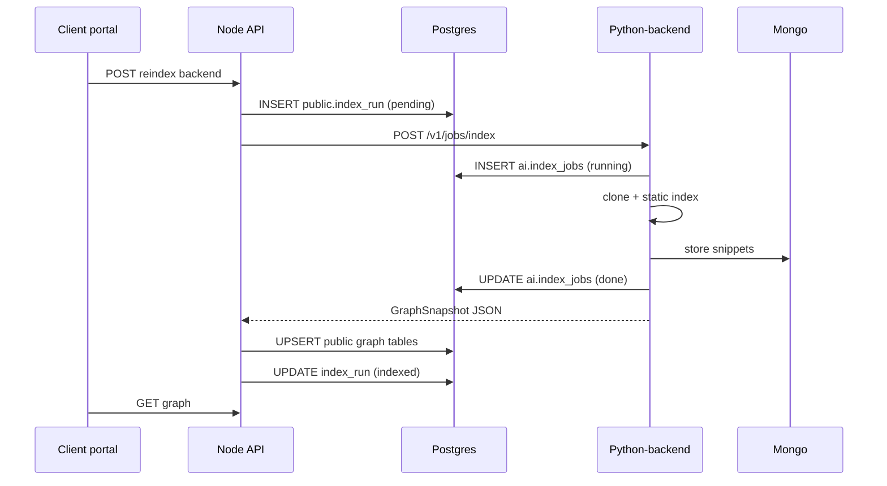

# Schema architecture (Node + Python)

Aazhi uses **one PostgreSQL database** (`aazhi`) with **multiple schemas** so each runtime owns its migrations and tables do not collide.

## PostgreSQL schemas

```text
┌─────────────────────────────────────────────────────────────────┐
│  Database: aazhi (single cluster, e.g. :5433)                   │
├─────────────────────────────────────────────────────────────────┤
│  public          │  Owned by Node / Prisma                      │
│                  │  users, roles, feature_flags, job_triggers,   │
│                  │  audit_events, client_schema_registry, …       │
│                  │  Future: backends, index_runs (portal source │
│                  │  of truth for client UI)                     │
├──────────────────┼──────────────────────────────────────────────┤
│  ai              │  Owned by Python-backend / Alembic           │
│                  │  index_jobs, decode_jobs, llm_usage, …       │
│                  │  Operational + worker state only             │
├──────────────────┼──────────────────────────────────────────────┤
│  client_<uuid>   │  Per-client app data (Node SQL migrations)   │
│                  │  Orders, etc. — not used by Python AI layer  │
└─────────────────────────────────────────────────────────────────┘
```

### Rules

1. **Prisma never touches `ai.*`** — add `schemas = ["public"]` only; no multi-schema Prisma unless you later need read-only views.
2. **Alembic never touches `public.*`** — migrations set `version_table_schema = ai` and create tables in `ai`.
3. **Cross-schema FKs are avoided** — link rows by UUID string (`client_user_id`, `backend_id`, `index_run_id`) assigned by Node.
4. **Canonical graph for the UI** lives in **`public`** (Node writes after job success). Python may cache the same snapshot in Mongo for RAG.

### Why not a second database?

Use **`ai` schema** first (simpler ops, one backup, same Docker Compose). Split to `aazhi_ai` database only if Python load or compliance requires hard isolation.

## MongoDB (shared database `aazhi`)

| Collection (convention) | Writer | Contents |
|-------------------------|--------|----------|
| `ai_repo_snapshots` | Python | File tree hashes, tarball refs, commit SHA |
| `ai_symbol_snippets` | Python | Source excerpts for assistant RAG |
| (existing Node docs) | Node | Unchanged |

Collection names are **not** SQL schemas; namespace with prefix `ai_` to avoid clashes.

## API contract schema (not SQL)

HTTP JSON bodies are defined in:

- `app/contracts/graph.py` — nodes, edges, `GraphSnapshot`
- `app/contracts/jobs.py` — index/decode job requests and responses

Node should treat these as the **versioned contract** (copy types to TypeScript or generate from OpenAPI at `http://localhost:4100/openapi.json`).

### Identity fields (always present on jobs)

| Field | Set by | Meaning |
|-------|--------|---------|
| `clientUserId` | Node | Tenant |
| `backendId` | Node | Registered Git service |
| `indexRunId` | Node | Correlates BullMQ + audit + UI status |

Python **must not** invent `backendId`; it only processes IDs Node already created.

## Migration workflow

| Change | Tool | Location |
|--------|------|----------|
| Portal users, backends registry | Prisma | `backend/prisma/schema.prisma` |
| Client business tables | SQL files | `backend/src/db/clientSchema/migrations/` |
| AI worker tables | Alembic | `Python-backend/alembic/versions/` |

### Bootstrap `ai` schema (once per environment)

```sql
CREATE SCHEMA IF NOT EXISTS ai;
GRANT USAGE ON SCHEMA ai TO aazhi;
GRANT ALL ON SCHEMA ai TO aazhi;
```

Alembic revision `0001` also runs `CREATE SCHEMA IF NOT EXISTS ai` for fresh installs.

## Sequence: index job



## LLM keys

- **Stored encrypted in `public`** (future `client_llm_settings`, same pattern as `email_settings`).
- Node decrypts per job and passes **short-lived** `openaiApiKey` / `googleApiKey` in the job body, or Python reads none and skips LLM pass.
- Keys are **never** persisted in `ai` tables (only provider name + token counts).

## Local dev alignment

| Service | Port | DB |
|---------|------|-----|
| Node API | 4000 | `DATABASE_URL` → `public` |
| Python-backend | 4100 | `DATABASE_URL` → search_path `ai` |

Both use the same `backend/docker-compose.yml` Postgres volume.
